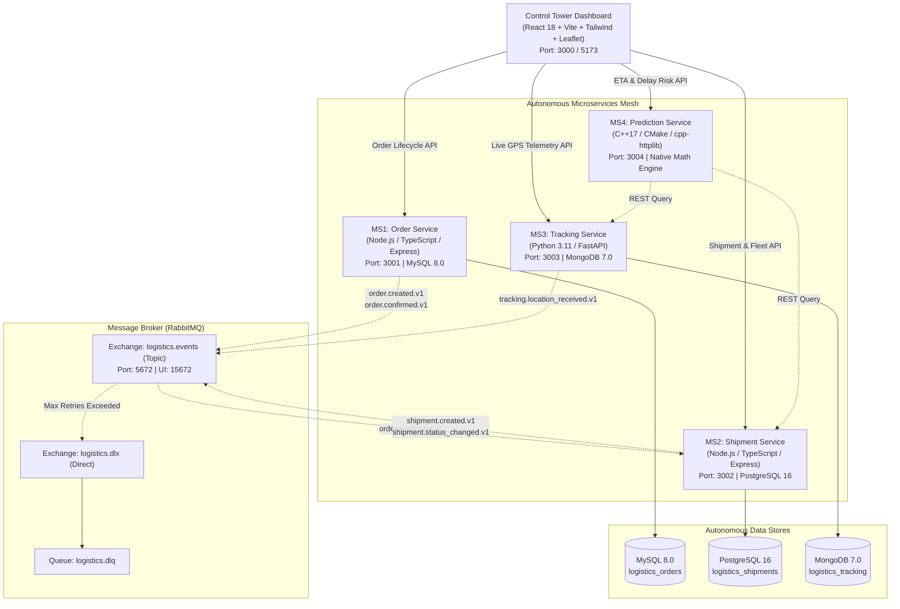

# Logistics Control Tower — Distributed Autonomous Monorepo

A production-grade, distributed, event-driven Logistics Control Tower platform designed to orchestrate freight order lifecycles, carrier assignments, real-time GPS telemetry ingestion, and explainable baseline ETA and delay-risk prediction.

---

## 1. System Architecture



---

## 2. Microservice Stack & Service Matrix

| Service | Technology Stack | Port | Primary Database | Key Responsibilities |
| :--- | :--- | :--- | :--- | :--- |
| **MS1 — Order Service** | Node.js, Express, TypeScript | `3001` | MySQL 8.0 (`3306`) | Exact decimal currency math, order lifecycle (`PENDING` $\rightarrow$ `CONFIRMED` $\rightarrow$ `CANCELLED`), idempotency key guarantees, transactional outbox worker. |
| **MS2 — Shipment Service** | Node.js, Express, TypeScript | `3002` | PostgreSQL 16 (`5432`) | Shipment staging, carrier / truck / driver allocation, status transitions, RabbitMQ consumer for `order.confirmed.v1`, outbox publisher. |
| **MS3 — Tracking Service** | Python, FastAPI, Motor | `3003` | MongoDB 7.0 (`27017`) | High-throughput GPS ingestion, latitude/longitude boundary validation, monotonic timestamp fencing, route GeoJSON generation, integrated GPS simulator. |
| **MS4 — Prediction Service** | C++17, CMake, `cpp-httplib` | `3004` | None (Direct HTTP/Math) | Deterministic Great-Circle Haversine distance, speed blending, estimated transit hours, multi-factor delay risk scoring (`LOW`, `MEDIUM`, `HIGH`, `CRITICAL`). |
| **Frontend Dashboard** | React 18, Vite, Tailwind CSS, Leaflet | `3000` | Browser State | Real-time KPI metric cards, orders page with create modal, fleet management, live interactive Leaflet OpenStreetMap tracking, shipment deep-dive modal, analytics dashboard. |
| **RabbitMQ Broker** | RabbitMQ 3.13 Management | `5672` (AMQP), `15672` (UI) | In-Memory / Disk Volume | Durable topic exchanges, dead-letter exchanges (`logistics.dlx`), idempotent consumers. |

---

## 3. Quick Start with Docker Compose (Recommended)

To start the complete platform including all 4 microservices, 3 databases, RabbitMQ broker with preconfigured exchanges/queues, and the React frontend dashboard:

```bash
# 1. Clone or enter the workspace
cd e:\map_assignment

# 2. Copy the environment configuration
cp .env.example .env

# 3. Build and launch all 9 containers
docker compose up -d --build
```

### Accessing Running Services & Dashboards

- **Frontend Control Tower Dashboard**: [http://localhost:3000](http://localhost:3000)
- **RabbitMQ Management Dashboard**: [http://localhost:15672](http://localhost:15672) (User: `guest`, Password: `guest`)
- **MS1 Order Service Health**: [http://localhost:3001/health](http://localhost:3001/health)
- **MS2 Shipment Service Health**: [http://localhost:3002/health](http://localhost:3002/health)
- **MS3 Tracking Service Health**: [http://localhost:3003/health](http://localhost:3003/health)
- **MS4 C++ Prediction Service Health**: [http://localhost:3004/health](http://localhost:3004/health)

---

## 4. End-to-End Operational Workflow

The system provides a seamless automated flow across services:

1. **Order Creation (MS1)**:
   Navigate to the **Orders** tab on the frontend (or POST `/api/v1/orders`). Submit an order with item lines and currency.
2. **Order Confirmation & Outbox Event (MS1 $\rightarrow$ MS2)**:
   Click **Confirm** on the pending order. MS1 updates status to `CONFIRMED` and stores `order.confirmed.v1` in its transactional outbox.
3. **Automated Shipment Provisioning (MS2)**:
   The Shipment Service RabbitMQ consumer receives `order.confirmed.v1`, verifies idempotency, and automatically stages a new shipment in PostgreSQL with origin and destination coordinates.
4. **Fleet Carrier Assignment (MS2)**:
   On the **Shipments** tab, click **+ Assign Carrier** to attach a carrier company, vehicle plate, and driver.
5. **GPS Movement Simulation (MS3)**:
   On the **Live Tracking** tab, select the shipment and click **Start / Reset Simulation** or **Advance 1 GPS Waypoint**. MS3 ingests realistic waypoints along the I-5 West Coast highway corridor and publishes `tracking.location_received.v1`.
6. **Real-time Baseline ETA & Delay Risk Prediction (MS4)**:
   Click the eye icon on any shipment to open the **Shipment Deep Dive**. MS4 evaluates remaining Haversine distance, speed, and scheduled delivery window, displaying predicted ETA, risk level, and explanatory factors.

---

## 5. Running Automated Tests

All services include dedicated automated unit and integration tests.

### Run All 5 Suites via Master Script

```powershell
.\tests\run_all_tests.ps1
```

### Run Tests by Service

- **MS1 (Order Service)**:
  ```bash
  cd services/order-service
  npm run test:unit
  ```
  *Result: 21 passed (validation, money arithmetic, idempotency, lifecycle)*

- **MS2 (Shipment Service)**:
  ```bash
  cd services/shipment-service
  npm run test:unit
  ```
  *Result: 5 passed (Zod input validation, coordinates range, state transitions)*

- **MS3 (Tracking Service)**:
  ```bash
  python -m pytest services/tracking-service/tests
  ```
  *Result: 7 passed (bounds validation, bearing calculations, route generation, monotonic timestamp fencing)*

- **MS4 (C++ Prediction Service)**:
  Tested automatically during multi-stage Docker build:
  ```bash
  docker build -t logistics-prediction-service services/prediction-service
  ```
  *Result: test_prediction passed (Haversine distance, speed blending, SLA delay risk scoring)*

- **Frontend Dashboard Build**:
  ```bash
  cd frontend
  npm run build
  ```
  *Result: TypeScript compilation and Vite production bundle generated successfully*

- **Cross-Service Contract & Sanity Suite**:
  ```bash
  python tests/e2e/test_e2e_flow.py
  ```
  *Result: 4 passed (Haversine contract, status machine, monotonic fencing, risk categorizations)*

---

## 6. API Documentation & Postman Collection

- Complete OpenAPI/REST API specification: [`docs/api-spec.md`](./docs/api-spec.md)
- Complete Event-driven RabbitMQ Contracts: [`docs/event-contracts.md`](./docs/event-contracts.md)
- Importable Postman Collection: [`docs/postman_collection.json`](./docs/postman_collection.json)

---

## 7. Clean Shutdown & Cleanup

To stop and remove all containers:

```bash
docker compose down
```

To stop containers and wipe database volumes for a clean reset:

```bash
docker compose down -v
```
