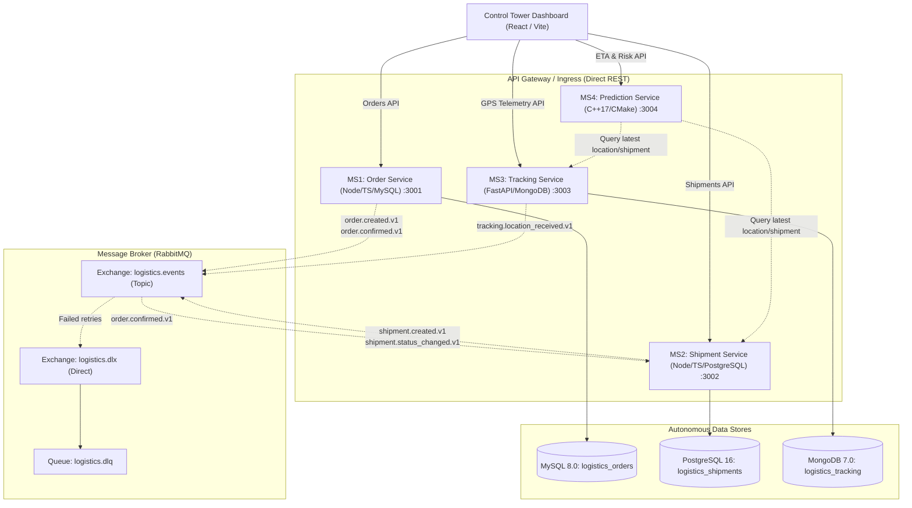

# Logistics Control Tower — Architecture Specification

## Overview

The Logistics Control Tower is a distributed, event-driven logistics management platform designed to orchestrate the end-to-end lifecycle of shipments: from customer order placement to carrier allocation, real-time GPS telemetry ingestion, and automated ETA/delay risk prediction.

---

## Autonomous Microservices

| Service | Technology Stack | Port | Primary Database | Key Responsibilities |
| :--- | :--- | :--- | :--- | :--- |
| **MS1: Order Service** | Node.js, Express, TypeScript | `3001` | MySQL 8.0 | Order lifecycle, validation, items, decimal money arithmetic, idempotency, transactional outbox. |
| **MS2: Shipment Service** | Node.js, Express, TypeScript | `3002` | PostgreSQL 16 | Shipment creation, carrier/driver/vehicle assignment, status state machine, outbox publisher, event consumer. |
| **MS3: Tracking Service** | Python 3.11+, FastAPI | `3003` | MongoDB 7.0 | High-throughput GPS ingestion, geo-validation, event deduplication, monotonic timestamp fencing, route history, GPS simulator. |
| **MS4: Prediction Service** | C++17, CMake, `cpp-httplib` | `3004` | None (Direct HTTP/Events) | Haversine distance, speed evaluation, deterministic baseline ETA calculation, multi-factor delay risk scoring. |
| **Frontend Dashboard** | React 18, TypeScript, Tailwind | `3000` / `5173` | Browser State | Real-time KPI cards, orders & shipments management, live Leaflet map with vehicle markers, GPS simulation controls, risk analytics. |

---

## Data Segregation & Ownership

In accordance with strict microservice domain-driven design:
- **No Shared Databases**: No service connects directly to another service's database.
- **Reference by Stable Identifiers**: Shipments refer to orders using `orderId` (UUID). GPS pings reference shipments using `shipmentId` (UUID).
- **Asynchronous Decoupling**: Order confirmation triggers shipment creation asynchronously via RabbitMQ (`order.confirmed.v1`).
- **Resilient Fallback**: If RabbitMQ is offline or undergoing maintenance, outbox workers queue events in their respective relational databases and automatically retry with exponential backoff.
