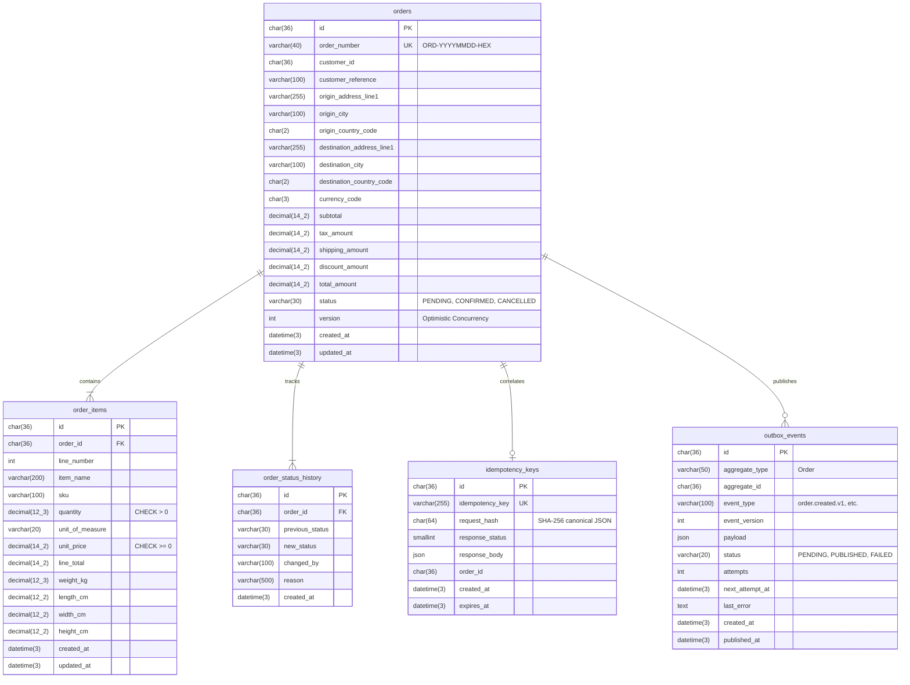

# Microservice 1: Order Service — Logistics Control Tower

A production-oriented, standalone Order Service built for the distributed **Logistics Control Tower** platform. The service is responsible for managing the initial stage of logistics workflows: validating and creating customer cargo orders, server-side monetary calculations, order lifecycle management, transactional outbox event publishing, and idempotency guarantees.

---

## Table of Contents
1. [Service Purpose & Bounded Context](#1-service-purpose--bounded-context)
2. [Architecture & Request Flow](#2-architecture--request-flow)
3. [Technology Stack](#3-technology-stack)
4. [Database Schema & ER Diagram](#4-database-schema--er-diagram)
5. [Local Development Setup (Windows PowerShell)](#5-local-development-setup-windows-powershell)
6. [Docker Compose Setup](#6-docker-compose-setup)
7. [Database Migrations & Seeding](#7-database-migrations--seeding)
8. [REST API Documentation & Endpoints](#8-rest-api-documentation--endpoints)
9. [Idempotency & Concurrency Strategy](#9-idempotency--concurrency-strategy)
10. [Transactional Outbox & RabbitMQ Integration](#10-transactional-outbox--rabbitmq-integration)
11. [Downstream Shipment Service Integration](#11-downstream-shipment-service-integration)
12. [Automated Testing & Build](#12-automated-testing--build)
13. [Security Assumptions & Limitations](#13-security-assumptions--limitations)

---

## 1. Service Purpose & Bounded Context

In the Logistics Control Tower distributed architecture, 5 distinct microservices operate autonomously:
- **Order Service (Microservice 1)**: TypeScript + Express.js + MySQL 8.0 (`logistics_orders`)
- **Shipment Service (Microservice 2)**: Java + Spring Boot + PostgreSQL
- **Tracking Service (Microservice 3)**: Go + MongoDB
- **AI Prediction Service (Microservice 4)**: Python + FastAPI + Redis
- **Dashboard / Search Service (Microservice 5)**: C# + .NET + Elasticsearch

### Bounded Context Rules
- The **Order Service owns order data exclusively**.
- It does **not** create shipment tables, GPS tracking collections, AI prediction tables, or Elasticsearch indices.
- It does **not** connect directly to databases owned by other services.
- It continues functioning independently even if downstream microservices are unavailable.
- Cross-service coordination occurs strictly via **REST APIs** and **asynchronous domain events** published through a **Transactional Outbox**.

---

## 2. Architecture & Request Flow

The service follows a layered domain architecture:

```
[ HTTP Client / Gateway ]
          │
          ▼
   [ Helmet & CORS ]
          │
          ▼
   [ Request ID & Rate Limiter ]
          │
          ▼
  [ Idempotency Middleware ] ──(Cache Hit?)──► [ Replay Cached Response ]
          │
          ▼
    [ Route Layer ] (src/routes/)
          │
          ▼
 [ Controller Layer ] (src/controllers/)
   - Validates input schemas (Zod)
          │
          ▼
   [ Service Layer ] (src/services/)
   - Decimal-safe monetary arithmetic (decimal.js)
   - Order lifecycle state machine validation
   - Manages atomic transactions
          │
          ▼
 [ Repository Layer ] (src/repositories/)
   - Parameterized SQL queries (mysql2/promise)
          │
          ▼
   [ MySQL 8.0 InnoDB ] (logistics_orders)
   - Atomic write: orders + order_items + order_status_history + outbox_events + idempotency_keys
```

---

## 3. Technology Stack

- **Runtime**: Node.js (v22+)
- **Language**: TypeScript (v5.7+)
- **Web Framework**: Express.js (v4.21+)
- **Database**: MySQL 8.0+ (InnoDB, `utf8mb4_unicode_ci`, UTC timestamps)
- **Database Driver**: `mysql2/promise` with parameterized queries and connection pooling
- **Validation**: Zod (v3.24+)
- **Monetary Arithmetic**: `decimal.js` (28-digit precision, ROUND_HALF_UP)
- **Structured Logging**: `pino` and `pino-http` (automatic sensitive data redaction)
- **Security**: `helmet`, `cors`, `express-rate-limit`
- **Asynchronous Messaging**: Pluggable `OutboxWorker` (AMQP Confirm Channel via `amqplib` or Log-Only worker)
- **Testing**: Vitest (v3.0+) + Supertest (v7.0+)
- **Containerization**: Multi-stage Dockerfile + Docker Compose

---

## 4. Database Schema & ER Diagram

The database is named `logistics_orders` (and `logistics_orders_test` for integration tests). All identifiers are UUID v4 stored as `CHAR(36)`. Timestamps use `DATETIME(3)` stored in UTC.



---

## 5. Local Development Setup (Windows PowerShell)

### Prerequisites
- Node.js v20+ or v22+
- Local MySQL 8.0 Server running on port 3306

### Step-by-Step PowerShell Setup

```powershell
# 1. Navigate to the Order Service directory
cd e:\map_assignment\order-service

# 2. Copy the environment template
Copy-Item .env.example .env

# 3. Configure credentials in .env (Default matches local setup: root / Het@2005)
# DB_HOST=localhost
# DB_PORT=3306
# DB_NAME=logistics_orders
# DB_USER=root
# DB_PASSWORD=Het@2005

# 4. Install dependencies
npm install

# 5. Run database migrations (automatically creates logistics_orders DB if absent)
npm run db:migrate

# 6. Seed demonstration orders (safe for repeated runs)
npm run db:seed

# 7. Start development server with hot-reload
npm run dev

# Or build and run production server
npm run build
npm start
```

---

## 6. Docker Compose Setup

A production-grade multi-container environment includes MySQL 8.0 and the containerized Order Service with automated readiness checks.

```powershell
# Navigate to order-service directory
cd e:\map_assignment\order-service

# Build and start services in detached mode
docker compose up -d --build

# View container logs
docker compose logs -f order-service

# Check container status
docker compose ps

# Run migrations inside container if needed
docker compose exec order-service npx tsx scripts/migrate.ts

# Tear down containers (preserving volume)
docker compose down

# Tear down with volume removal
docker compose down -v
```

---

## 7. Database Migrations & Seeding

Migrations are located in `migrations/*.sql` and tracked sequentially in `schema_migrations`.

| Script | Command | Description |
|---|---|---|
| Migration Runner | `npm run db:migrate` | Applies pending `.sql` files in alphabetical order. Idempotent and safe to run multiple times. |
| Seed Generator | `npm run db:seed` | Populates demonstration orders (`PENDING`, `CONFIRMED`, `CANCELLED`) with cargo lines, status histories, and outbox entries. Prevents duplicate keys. |
| Database Reset | `npm run db:reset` | Drops development/test database and re-runs all migrations. Blocked automatically in production. |

---

## 8. REST API Documentation & Endpoints

Base URL: `http://localhost:3001`
Prefix: `/api/v1`

### Standard Response Envelopes

#### Success Envelope (HTTP 200 / 201)
```json
{
  "success": true,
  "data": { ... },
  "meta": {
    "requestId": "a55059c1-0dcb-40a0-9dce-5c3cd502c279",
    "pagination": {
      "page": 1,
      "limit": 20,
      "total": 4,
      "totalPages": 1
    }
  }
}
```

#### Error Envelope (HTTP 400 / 404 / 409 / 422 / 500)
```json
{
  "success": false,
  "error": {
    "code": "VALIDATION_ERROR",
    "message": "The request contains invalid fields.",
    "details": [
      {
        "field": "items",
        "message": "At least one item is required."
      }
    ]
  },
  "meta": {
    "requestId": "082a92d5-c58c-4ebc-9c94-5593967631ca"
  }
}
```

---

### Endpoint Reference

#### 1. Service Health (Liveness)
- **Method / Path**: `GET /health`
- **Description**: Returns 200 OK liveness status without exposing internal state.
- **PowerShell Example**:
  ```powershell
  Invoke-RestMethod -Uri "http://localhost:3001/health" | ConvertTo-Json
  ```

#### 2. Service Readiness
- **Method / Path**: `GET /ready`
- **Description**: Verifies that MySQL connection pool is responsive (`SELECT 1`). Returns 200 when ready, 503 if unreachable.
- **PowerShell Example**:
  ```powershell
  Invoke-RestMethod -Uri "http://localhost:3001/ready" | ConvertTo-Json
  ```

#### 3. Create Order
- **Method / Path**: `POST /api/v1/orders`
- **Headers**:
  - `Content-Type: application/json`
  - `Idempotency-Key: <unique-client-key>` (Required)
- **Request Body**:
  ```json
  {
    "customerId": "a9a6f5e4-1234-4567-8901-123456789012",
    "customerReference": "PO-2026-001",
    "currencyCode": "INR",
    "origin": {
      "addressLine1": "Warehouse 1, GIDC",
      "city": "Anand",
      "state": "Gujarat",
      "postalCode": "388001",
      "countryCode": "IN"
    },
    "destination": {
      "addressLine1": "Distribution Centre",
      "city": "Ahmedabad",
      "state": "Gujarat",
      "postalCode": "380001",
      "countryCode": "IN"
    },
    "items": [
      {
        "itemName": "Industrial Components",
        "sku": "COMP-001",
        "quantity": 10,
        "unitOfMeasure": "PCS",
        "unitPrice": 150.00,
        "weightKg": 25
      }
    ],
    "taxAmount": 100,
    "shippingAmount": 250,
    "discountAmount": 50,
    "notes": "Handle carefully",
    "requestedPickupAt": "2026-10-22T08:00:00.000Z",
    "requestedDeliveryAt": "2026-10-23T16:00:00.000Z"
  }
  ```
- **Monetary Rules**:
  - `subtotal` = server-calculated sum of `quantity * unitPrice`.
  - `totalAmount` = `subtotal + taxAmount + shippingAmount - discountAmount`.
  - Client-submitted totals are ignored and recalculated.
  - Discount cannot exceed subtotal + tax + shipping.
- **Returns**: HTTP 201 Created on first execution; HTTP 200/201 replay on identical duplicate key.

#### 4. Get Order by ID
- **Method / Path**: `GET /api/v1/orders/:id`
- **Description**: Returns order details and cargo line items. Returns 404 if not found.
- **PowerShell Example**:
  ```powershell
  Invoke-RestMethod -Uri "http://localhost:3001/api/v1/orders/10000000-0000-4000-8000-000000000001" | ConvertTo-Json -Depth 5
  ```

#### 5. Get Order by Order Number
- **Method / Path**: `GET /api/v1/orders/number/:orderNumber`
- **Description**: Retrieves order using human-readable number format (`ORD-YYYYMMDD-XXXXXXXX`).
- **PowerShell Example**:
  ```powershell
  Invoke-RestMethod -Uri "http://localhost:3001/api/v1/orders/number/ORD-20261021-SEED001" | ConvertTo-Json -Depth 5
  ```

#### 6. List & Filter Orders
- **Method / Path**: `GET /api/v1/orders`
- **Query Parameters**:
  - `page`: default 1
  - `limit`: default 20 (max 100)
  - `status`: `PENDING` | `CONFIRMED` | `CANCELLED`
  - `customerId`: UUID
  - `orderNumber`: string search (partial matching)
  - `createdFrom`: ISO 8601 date
  - `createdTo`: ISO 8601 date
  - `sortBy`: `createdAt` | `totalAmount` | `orderNumber` | `status`
  - `sortOrder`: `asc` | `desc` (default `desc`)
- **PowerShell Example**:
  ```powershell
  Invoke-RestMethod -Uri "http://localhost:3001/api/v1/orders?status=PENDING&page=1&limit=10" | ConvertTo-Json -Depth 5
  ```

#### 7. Update Permitted Order Fields
- **Method / Path**: `PATCH /api/v1/orders/:id`
- **Permitted Fields**: `customerReference`, `origin`, `destination`, `notes`, `requestedPickupAt`, `requestedDeliveryAt`, `version`.
- **Forbidden Fields**: `id`, `orderNumber`, `customerId`, `status`, `subtotal`, `taxAmount`, `shippingAmount`, `discountAmount`, `totalAmount`, `createdAt`.
- **Optimistic Locking**: Pass the current `version`. If another process updated the record concurrently, the API returns HTTP 409 `STALE_ORDER_VERSION`.
- **Request Body**:
  ```json
  {
    "version": 1,
    "customerReference": "PO-2026-REV-2",
    "notes": "Deliver strictly between 9 AM and 1 PM."
  }
  ```

#### 8. Confirm Order
- **Method / Path**: `POST /api/v1/orders/:id/confirm`
- **Headers**: `X-Actor-Id: <user-id>` (Optional)
- **Lifecycle Rule**: Valid only when status is `PENDING`. Transitions order to `CONFIRMED`, increments version, writes status history, and generates `order.confirmed.v1` outbox event.
- **PowerShell Example**:
  ```powershell
  Invoke-RestMethod -Uri "http://localhost:3001/api/v1/orders/10000000-0000-4000-8000-000000000001/confirm" -Method Post | ConvertTo-Json
  ```

#### 9. Cancel Order
- **Method / Path**: `POST /api/v1/orders/:id/cancel`
- **Headers**: `X-Actor-Id: <user-id>` (Optional)
- **Request Body**:
  ```json
  {
    "reason": "Client cancelled shipment before dispatch."
  }
  ```
- **Lifecycle Rule**:
  - `PENDING` -> `CANCELLED` (Allowed)
  - `CONFIRMED` -> `CANCELLED` (Allowed with reason and audit log)
  - `CANCELLED` -> Terminal state; rejects further transitions with HTTP 409 `ORDER_STATE_CONFLICT`.

#### 10. Order Status History
- **Method / Path**: `GET /api/v1/orders/:id/history`
- **Description**: Returns chronological status transition history including previous status, new status, actor, reason, and timestamp.
- **PowerShell Example**:
  ```powershell
  Invoke-RestMethod -Uri "http://localhost:3001/api/v1/orders/10000000-0000-4000-8000-000000000001/history" | ConvertTo-Json
  ```

---

## 9. Idempotency & Concurrency Strategy

1. **Deterministic Hashing**: The request body is recursively canonicalized (keys sorted) and hashed using SHA-256.
2. **Atomic Reservation**: When `POST /api/v1/orders` executes, the `idempotency_keys` record is created inside the same MySQL transaction as the order, order items, status history, and outbox event.
3. **Replay vs Conflict**:
   - **Identical Retries**: If the same key and same body are sent again, the stored response (`status` and `body`) is replayed with header `X-Idempotent-Replay: true`.
   - **Key Conflict**: If the same key is reused with a different request payload, the API returns HTTP 409 `IDEMPOTENCY_KEY_CONFLICT`.
   - **In-flight Requests**: If an identical key is received while the first request is actively writing, HTTP 409 Conflict is returned to avoid concurrent duplicate creation.
4. **Optimistic Locking**: Every update to an order checks `WHERE id = ? AND version = ?` and increments `version = version + 1`. Stale concurrent writes return HTTP 409 `STALE_ORDER_VERSION`.

---

## 10. Transactional Outbox & RabbitMQ Integration

Directly publishing to RabbitMQ before a database transaction commits can leak "phantom events" if the database rolls back. Conversely, committing the transaction and failing to publish can cause lost events.

### Outbox Pattern Implementation:
1. In the same MySQL transaction that modifies an order:
   - Order record updated.
   - Status history recorded.
   - Outbox event inserted into `outbox_events` table with status `'PENDING'`.
2. A background worker (`OutboxWorker`) polls pending events:
   - Dispatches events to RabbitMQ with **publisher confirms**.
   - Upon broker confirmation, updates `outbox_events` to `'PUBLISHED'`.
   - Upon broker failure or network partition, calculates exponential backoff (`min(300, 2^attempts * 5)` seconds), records `last_error`, and schedules the next retry.
3. **Pluggable Architecture**:
   - When `RABBITMQ_ENABLED=false` (default for local development), `LogOnlyPublisher` runs without requiring an AMQP broker.
   - When `RABBITMQ_ENABLED=true`, `RabbitMQPublisher` connects to `RABBITMQ_URL`, asserts durable topic exchange `logistics.orders.exchange`, and publishes persistent messages.

### Event Format (`order.created.v1`)
```json
{
  "eventId": "f2e4b6c8-1234-4000-8000-111122223333",
  "eventType": "order.created.v1",
  "eventVersion": 1,
  "occurredAt": "2026-10-21T18:40:00.000Z",
  "producer": "order-service",
  "aggregateId": "88aa125c-1212-404b-9e27-fc339a7935df",
  "correlationId": "req-19bb8eee",
  "orderId": "88aa125c-1212-404b-9e27-fc339a7935df",
  "orderNumber": "ORD-20261021-EE6200B4",
  "customerId": "a9a6f5e4-1234-4567-8901-123456789012",
  "currencyCode": "INR",
  "subtotal": "1000.00",
  "totalAmount": "1125.00",
  "status": "PENDING",
  "origin": { "city": "Anand", "countryCode": "IN" },
  "destination": { "city": "Ahmedabad", "countryCode": "IN" },
  "itemCount": 1,
  "items": [
    {
      "lineNumber": 1,
      "itemName": "Industrial Sensor Unit",
      "quantity": "5.000",
      "unitOfMeasure": "PCS",
      "lineTotal": "1000.00"
    }
  ]
}
```

---

## 11. Downstream Shipment Service Integration

The Java + Spring Boot + PostgreSQL **Shipment Service (Microservice 2)** will consume order events:

```
[ Order Service ]
       │
       ▼ (MySQL Transaction)
[ outbox_events ]
       │
       ▼ (OutboxWorker)
[ RabbitMQ Topic Exchange: logistics.orders.exchange ]
   Routing key: order.created.v1 / order.confirmed.v1
       │
       ▼ (Queue: shipment-service.order-events)
[ Java Spring Boot Shipment Service ]
   - Reads event envelope
   - Deduplicates by `eventId` in PostgreSQL idempotency table
   - Checks order status (CONFIRMED)
   - Creates new Shipment record in PostgreSQL
```

### At-Least-Once Delivery & Deduplication
Because worker crashes can occur between broker publish and marking an outbox row as published, events are delivered with **at-least-once semantics**. Downstream consumers (including the Shipment Service) **must deduplicate messages using `eventId`**.

---

## 12. Automated Testing & Build

The project includes unit tests and full-stack HTTP integration tests against an isolated test database (`logistics_orders_test`).

```powershell
# Run all tests (Unit + Integration)
npm run test

# Run unit tests only (Fast, no DB needed)
npm run test:unit

# Run integration tests only (Uses test database)
npm run test:integration

# Type check (Linting)
npm run lint

# Compile TypeScript to dist/
npm run build
```

---

## 13. Security Assumptions & Limitations

1. **Authentication Boundary**: Authentication and tenant authorization middleware integration points are designed (`X-Actor-Id`, request scoping). In production, this service must sit behind an API Gateway that verifies JWTs and attaches validated actor identities.
2. **Customer ID**: `customerId` is an identifier from an external customer master service; it does not confer authorization on its own.
3. **Shipment State Verification**: When cancelling a `CONFIRMED` order, the Order Service allows business cancellation under documented policy. Once Microservice 2 is deployed, a synchronous gRPC/REST probe or event saga will verify that shipment dispatch has not begun.
4. **Idempotency Key TTL**: Expired idempotency keys are retained for 24 hours (`IDEMPOTENCY_KEY_TTL_HOURS`) and can be pruned via `idempotencyRepository.cleanupExpired()`.
